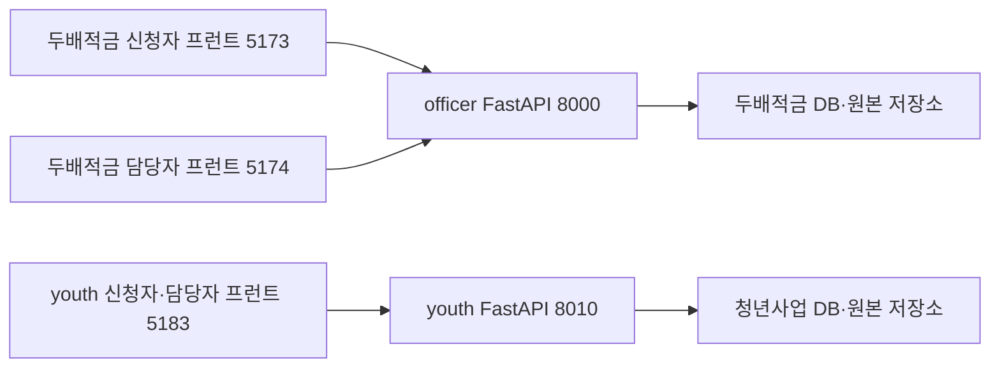

# 전북 청년정책 신청서류 검토 시스템

## 1. 프로젝트 소개

전북 청년정책의 신청·서식 작성·서류 확인·담당자 심사를 돕는 학생 팀 개발 결과물입니다. 두배적금과 청년 취업지원패키지의 서로 다른 업무 규칙을 유지하면서 문서 인식·정보 추출·명시적 규칙 판정과 담당자 검토를 연결합니다. **PRODUCTION_NOT_READY.**

## 2. 캡스톤디자인·도청 협력 배경

이 프로젝트는 **전북대학교 캡스톤디자인 교과목에서 전북특별자치도청과 협력하여 수행한 학생 팀 프로젝트**입니다. 학교 수업의 일부로 실제 행정 업무의 기술적 개선을 탐구한 결과물이며, 도청 공식 운영 시스템으로 배포되었거나 운영 승인을 받은 서비스라는 뜻은 아닙니다.

이 대표 저장소는 캡스톤 과제 소개·기술 문서·검증 버전 안내를 제공합니다. 세 개발 저장소를 monorepo로 합치거나 전체 소스를 이곳에 중복 복사하지 않습니다. 기존 초기 코드·역사 자료·팀원 기여·Git 이력과 `archive/main-before-split` 등 태그는 보존합니다. 비공개 소스 2,423개 파일 보관본은 재현·인수인계용으로 유지하며 GitHub에 새로 공개하지 않습니다.

## 3. 해결하려는 행정 업무 문제

신청자는 공고문 서식을 작성하고 여러 증빙을 준비해야 하며, 접수 후에야 미비 내용을 알면 재제출을 반복하게 됩니다. 담당자는 원본을 열어 문서 종류·발급일·자격·신청 금액과 사업별 기준을 대조해야 합니다. 이 프로젝트는 제출 상태와 확인할 근거를 정리하고, 불확실한 내용과 수동 검토 대상을 담당자에게 연결하는 것을 목표로 합니다. 업무 시간 절감률이나 실서류 전체 정확도를 입증했다고 주장하지 않습니다.

## 4. 전체 서비스 구성



두배적금 연결 실행은 officer 백엔드 하나를 사용합니다. applicant 보존 백엔드와 capstone 보존 백엔드를 같은 인증 서비스로 취급하지 않습니다. youth는 독립 백엔드·DB입니다. 위 포트는 README 개발 예시이며 실운영 구성 승인이 아닙니다.
## 5. OCR·Document AI 작동 구조

최신 개발 저장소의 `demo/backend`가 업로드·보존·체크리스트·제출·심사를 담당합니다. `engine_v2`는 OCR·분류·문서별 필드/좌표/신뢰도 추출, `engine`과 백엔드 규칙은 판정에 사용됩니다. 일반 OCR 체인은 fixture → 조건부 JBAI → LocalOcr → PDF text → 상용 스텁입니다. Upstage는 완성된 상용 연동이 아닙니다. own은 로컬 기본 선택이며 모델은 별도 설치·고정 해시 검증 대상입니다. 기본 선택에서 모델이 없으면 easyocr를 선택하지만 기본 requirements에 easyocr가 설치되는 것은 아닙니다. 명시한 own 오류는 다른 엔진으로 대체하지 않습니다.

두배적금 신청자에게는 `UPLOADED`/`REUPLOAD_REQUIRED`와 허용된 재업로드 사유만 투영합니다. 내부 `PASS`/`FAIL`/`NEEDS_REVIEW`, 점수·OCR 신뢰도·담당자 이유는 별개입니다. 서버가 submit에서도 기존 차단 조건을 재검사합니다. officer는 신청 소유자 쿠키와 담당자 로그인 세션을 구분하며 원본과 담당자 작성 PDF 접근을 보호합니다.

**youth canonical `PAYMENT_RECEIPT`는 수동 검토**입니다. 원본 envelope·열람 가능 여부만 확인하고 OCR·Document AI·필드 추출·신뢰도·화질 평가를 우회해 `NEEDS_REVIEW / RECEIPT_MANUAL_REVIEW`로 보존합니다. 담당자가 원본·신청 금액을 보고 기존 메모·결정에 기록합니다. 합본 하나로 다른 칸을 자동 충족시키지 않고 과거 저장 OCR·판정을 다시 쓰지 않습니다. [영수증 안내](https://github.com/zohijin-k/26-2-youth/blob/main/docs/receipt-manual-review.md)를 보세요.

## 6. 주요 구현 기능

- 신청자: 본인인증 데모, 원본 PDF 서식 작성·서명, 업로드 대기열·재업로드 안내, 제출·접수증·진행 조회.
- 두배적금 담당자: 역할·지역별 목록, 원본·판독 근거·심사 내용 조회, 메모·결정·일괄 처리.
- youth: 공고문·서식 기반 범용 사업 작성·검토·게시, 사업별 신청·제출·담당자 심사, 영수증 원본 수동 검토.
- 데이터 안전성: 제출 후 문서 변경 차단, 소유자·담당자 원본 접근 통제, 불완전한 근거가 그대로 PASS로 흘러가지 않도록 사업별 규칙·서버 제출 검사와 기존 반례 회귀 유지. 모든 오판을 방지한다는 보장은 아닙니다.

담당자 결정·메모는 `expected_revision`, 일괄 처리는 `expected_revisions`를 보내는 Review CAS(compare-and-swap)를 사용합니다. 오래된 revision은 충돌로 처리하며 전체 심사 내용을 덮어쓰지 않습니다. 제출 후 문서 변경 잠금과 트랜잭션 회귀도 유지합니다. 세션은 단일 프로세스 가정을 포함하므로 다중 worker 안전성을 보장하지 않습니다.

## 7. 신청자·담당자 사용자 흐름

두배적금은 **신청자 본인인증 데모 → 서식 작성·서명 → 서류 업로드·확인 → 제출 → 담당자 원본·근거 검토 → 메모·결정**으로 이어집니다. 신청자 프런트와 담당자 프런트는 officer API 하나에 연결합니다.

youth는 **담당자 공고문·서식 초안 확인 및 게시 → 신청자 사업 선택 → 본인인증 데모·서식·증빙 → 제출 → 권한 있는 담당자 심사** 흐름입니다. 영수증은 자동 OCR 승인 단계 없이 원본 수동 검토로 이어지고, 나머지 서류에는 현재 youth 정책을 적용합니다.

## 8. 네 저장소 역할과 실제 소스 링크

| 저장소 | 현재 역할 |
|---|---|
| [capstone](https://github.com/zohijin-k/26-2-capstone) | 전체 안내·분리 전 코드와 이력 보관 |
| [officer](https://github.com/zohijin-k/26-2-savings-officer) | 두배적금 공용 백엔드 + 담당자 프런트 |
| [applicant](https://github.com/zohijin-k/26-2-savings-applicant) | 두배적금 신청자 프런트 |
| [youth](https://github.com/zohijin-k/26-2-youth) | 취업지원패키지·범용 청년사업의 독립 백엔드 + 신청자·담당자 프런트 |
개발·실행의 기준은 위 세 개발 저장소입니다. 이 저장소의 보존 코드를 최신 세 앱의 통합 런타임으로 설명하지 않습니다. 기존 파일을 대규모 이동하거나 삭제하지 않습니다.

## 9. 기술 스택

React·TypeScript·Vite 프런트, FastAPI·SQLModel·SQLite 백엔드, PDF.js 원본 보기, PyMuPDF 문서 처리와 ONNX Runtime 기반 로컬 own OCR을 사용합니다. 저장소·사업별 판정 규칙과 외부 OCR/LLM 선택 기능은 구분합니다.

검증 환경은 **CPython 3.14.6 / macOS 26.6.2 / arm64, Node 26.13.1 / npm 11.20.0**입니다. 최신 코드의 Python 3.12·Linux·Windows 전체 실행은 미검증입니다. 과거 WSL 결과를 최신 main의 보장으로 사용하지 않습니다. Node의 직접 TypeScript 시험은 22.18 이상이 필요하며, 여기서는 위 실측 버전을 기준으로 합니다.

[`package-lock.json`](demo/frontend/package-lock.json)의 실제 잠금 버전은 React **19.3.0**, Vite **8.3.0**, TypeScript **6.0.3**, pdfjs-dist **5.7.284**입니다. Python 잠금은 FastAPI **0.162.2**, uvicorn **0.54.0**, SQLModel **0.0.44**, ONNX Runtime **1.31.1**, pytest **9.2.0** 등 55개 패키지를 포함합니다. [hash lock](demo/backend/locks/macos-arm64-py314.txt)과 [재현 범위](demo/backend/locks/README.md)를 확인하세요. 이 macOS 전용 lock을 다른 OS에 적용하거나 기존 requirements의 하한을 지원 보장으로 해석하지 않습니다. 프런트 package `0.0.0`·API 선언 `0.1.0`은 제품 릴리스 번호가 아닙니다.
## 10. 개발 및 검증 결과

다음은 **이전 기술 PR HEAD의 전체 시험**과 **해당 코드 main의 선택된 핵심 시험** 기록입니다. 이번 README 작업에서 전체 suite를 새로 실행했다고 주장하지 않습니다. 검증 HEAD와 코드 main의 실행 코드·기존 시험·프런트 tree 동일성(추가 lock 제외)을 확인해 연결했습니다.

| 저장소 | 기술 PR | 기존 전체 Python 통과 | 기존 프런트 통과 | 코드 main 핵심 통과 |
|---|---|---:|---:|---:|
| officer | [#43](https://github.com/zohijin-k/26-2-savings-officer/pull/43), [#44](https://github.com/zohijin-k/26-2-savings-officer/pull/44) | 5,124 | 70 | 171 |
| youth | [#39](https://github.com/zohijin-k/26-2-youth/pull/39) | 3,601 | 138 | 43 |
| applicant | [#17](https://github.com/zohijin-k/26-2-savings-applicant/pull/17) | 2,606 | 98 | 41 |
| capstone | [#37](https://github.com/zohijin-k/26-2-capstone/pull/37), [#38](https://github.com/zohijin-k/26-2-capstone/pull/38) | 2,494 | 1 | 21 |

기존 Python 전체 **13,825**개, 핵심 **276**개는 실패·오류·skip 0입니다. 자산이 없는 필터 사본에서도 이 수치가 그대로 나온다는 보장은 아닙니다. officer/youth에는 GitHub Actions의 event/pr-head/latest-main backend/frontend 검증이 있습니다. applicant/capstone에는 hosted CI가 없으므로 로컬 결과만 주장합니다. 기존 bundle·deprecation·Fast Refresh 경고는 유지합니다.

이번 README 정리의 첫 병합 전에는 실제 문서 PR HEAD의 기존 핵심 시험 **276개**를 별도 실행하여 실패·오류·skip 0을 확인했습니다. 이 후속 변경은 프로젝트 배경·문서 구조만 보완하며 실행 코드·정책·기존 시험을 바꾸지 않습니다. 문서 HEAD의 링크·명령·버전·모델 해시·과거 결과 출처를 별도로 검증합니다.

### release-manifest

아래는 README 정리 직전 확인한 **최신 코드 main SHA**와 검증 범위의 공개 요약입니다. README-only merge로 main SHA는 바뀌지만 실행 코드·정책은 바뀌지 않습니다. 현재 main SHA와 문서 병합 이력은 각 저장소의 GitHub main/PR에서 조회하며, 자기 자신의 미래 merge SHA를 이 파일에 하드코딩하지 않습니다. 전체 내부 `release-manifest.final.json`·소스 스냅샷·검증 증거는 비공개 보존 대상이며 이 요약은 소스 재배포 허가가 아닙니다.

```json
{
  "schema_version": 1,
  "production": "PRODUCTION_NOT_READY",
  "observation_date": "2026-11-23 KST",
  "scope": "immutable code validation baselines plus live current-main endpoints; final README merge SHAs are recorded in the private final release-manifest",
  "source_redistribution_authorized": false,
  "repositories": {
    "officer": {
      "repository": "zohijin-k/26-2-savings-officer",
      "code_main_sha": "006f151b67801340bc50302ec2d66dd900024b0b",
      "prior_full_python_passed": 5124,
      "prior_frontend_passed": 70,
      "final_code_core_passed": 171,
      "readme_main_before_context_update": "6b68eb44e77e5e401477ddf3ae5bd7f44aacffd9",
      "current_main_api": "https://api.github.com/repos/zohijin-k/26-2-savings-officer/commits/main"
    },
    "applicant": {
      "repository": "zohijin-k/26-2-savings-applicant",
      "code_main_sha": "a3baa5efe948800568c645c7736f2839f2af3e07",
      "prior_full_python_passed": 2606,
      "prior_frontend_passed": 98,
      "final_code_core_passed": 41,
      "readme_main_before_context_update": "eebcf2931195c85d4b3eb862f223113c1343a090",
      "current_main_api": "https://api.github.com/repos/zohijin-k/26-2-savings-applicant/commits/main"
    },
    "youth": {
      "repository": "zohijin-k/26-2-youth",
      "code_main_sha": "2fcfeffe9b3645e99ccb6ec4addc1c3f2e596dbf",
      "prior_full_python_passed": 3601,
      "prior_frontend_passed": 138,
      "final_code_core_passed": 43,
      "readme_main_before_context_update": "4d6aec3a66068bcaa2a32e787e12877a38b3d220",
      "current_main_api": "https://api.github.com/repos/zohijin-k/26-2-youth/commits/main"
    },
    "capstone": {
      "repository": "zohijin-k/26-2-capstone",
      "code_main_sha": "657c926be7ae7edf9c062728d5991e172a889772",
      "prior_full_python_passed": 2494,
      "prior_frontend_passed": 1,
      "final_code_core_passed": 21,
      "readme_main_before_context_update": "83f4935eb12a04cab372c5fad563c7e486cce41c",
      "current_main_api": "https://api.github.com/repos/zohijin-k/26-2-capstone/commits/main"
    }
  }
}
```

최신 ref는 저장소마다 아래 명령으로 재확인합니다.

```bash
git rev-parse HEAD
git ls-remote origin refs/heads/main
```

## 11. 실행·테스트 문서 연결

- [officer 설치·담당자·공용 API](https://github.com/zohijin-k/26-2-savings-officer#readme): Python venv·hash lock·`.env`를 준비해 8000에서 실행합니다.
- [applicant 프런트](https://github.com/zohijin-k/26-2-savings-applicant#readme): `demo/frontend`의 `npm ci`, `npm run dev -- --port 5173 --strictPort`; officer 프런트는 5174입니다.
- [youth 독립 실행](https://github.com/zohijin-k/26-2-youth#readme): API 8010, `VITE_API_TARGET=http://127.0.0.1:8010`의 프런트 5183입니다.

실제 API 저장소의 `.env`에 `OFFICER_PASSWORD`·`OFFICER_SESSION_SECRET`을 설정하고 uvicorn `--env-file .env`로 읽습니다. youth 예제에 빠진 두 키는 로컬 `.env`에 추가합니다. 키가 없으면 담당자 API가 503으로 차단됩니다. 프런트에 비밀값을 넣지 않습니다. 합성 로컬 실행은 `JBAI_API_KEY`를 비우고 `JBAI_ALLOW_REAL_DOCS=false`, `PROGRAM_LLM_ENABLED=false`, youth `LLM_PROVIDER=none`을 유지합니다. JBAI OCR은 키·허용 플래그를 켜면 이미지 외부 전송이 가능하며 예제의 기존 문구가 기관 승인을 대신하지 않습니다. 담당자 요약과 공고문 제안은 판정과 별개인 선택 기능입니다.

[보존 코드 개발 문서](docs/DEVELOPMENT.md)·[사용 문서](docs/USER_GUIDE.md)·[엔진 문서](engine_v2/README.md)는 이 저장소의 과거 코드 범위입니다. 최신 기능·실행·시험은 위 개발 저장소 README를 우선 대조하세요.

<details>
<summary>capstone 보존 코드 자체의 로컬 재현·시험</summary>

최신 세 앱 연결과 별개로 보존 코드 자체를 연구할 때만 새 개발 사본에서 실행합니다.

검증 환경은 **CPython 3.14.6 / macOS 26.6.2 / arm64, Node 26.13.1 / npm 11.20.0**입니다. 최신 코드의 Python 3.12·Linux·Windows 전체 실행은 미검증입니다. 과거 WSL 결과를 최신 main의 보장으로 사용하지 않습니다. Node의 직접 TypeScript 시험은 22.18 이상이 필요하며, 여기서는 위 실측 버전을 기준으로 합니다.

[`package-lock.json`](demo/frontend/package-lock.json)의 실제 잠금 버전은 React **19.3.0**, Vite **8.3.0**, TypeScript **6.0.3**, pdfjs-dist **5.7.284**입니다. Python 잠금은 FastAPI **0.162.2**, uvicorn **0.54.0**, SQLModel **0.0.44**, ONNX Runtime **1.31.1**, pytest **9.2.0** 등 55개 패키지를 포함합니다. [hash lock](demo/backend/locks/macos-arm64-py314.txt)과 [재현 범위](demo/backend/locks/README.md)를 확인하세요. 이 macOS 전용 lock을 다른 OS에 적용하거나 기존 requirements의 하한을 지원 보장으로 해석하지 않습니다. 프런트 package `0.0.0`·API 선언 `0.1.0`은 제품 릴리스 번호가 아닙니다.
```bash
# 새 로컬 개발 사본의 루트; 위 macOS/arm64·CPython 3.14.6 환경
python3.14 -m venv .venv
source .venv/bin/activate
python -m pip install --require-hashes --only-binary=:all: -r demo/backend/locks/macos-arm64-py314.txt
python -m pip check
cp .env.example .env
cd demo/frontend
npm ci
cd ../..
```

기존 [`demo/backend/requirements.txt`](demo/backend/requirements.txt)·[`engine_v2/requirements.txt`](engine_v2/requirements.txt)는 일반 의존성 선언이며 위 재현용 lock과 목적이 다릅니다. 모델·합성 시험용 글꼴은 lock에 포함되지 않습니다.

```bash
# capstone 루트, 합성 데이터만 사용
JBAI_API_KEY= JBAI_ALLOW_REAL_DOCS=false PROGRAM_LLM_ENABLED=false python -m uvicorn demo.backend.main:app --env-file .env --reload --host 127.0.0.1 --port 8000
```

다른 터미널의 `demo/frontend`에서 `npm run dev -- --port 5173 --strictPort`를 실행합니다. <http://localhost:5173>과 <http://localhost:8000/docs>를 사용합니다. 이 보존 백엔드에 officer/youth 최신 인증·수동 영수증 정책이 모두 존재한다고 가정하지 않습니다.

모델은 `python -m engine_v2.tools.fetch_own_models`로 별도 다운로드하고 `python -c "from engine_v2.tools.fetch_own_models import verify_models; verify_models()"`로 검증합니다. [`fetch_own_models.py`](engine_v2/tools/fetch_own_models.py)의 고정 SHA-256은 다음과 같습니다.

| 모델 | SHA-256 |
|---|---|
| `det.onnx` | `4d97c44a20d30a81aad087d6a396b08f786c4635742afc391f6621f5c6ae78ae` |
| `rec.onnx` | `cd6e2ea50f6943ca7271eb8c56a877a5a90720b7047fe9c41a2e541a25773c9b` |
| `korean_dict.txt` | `a88071c68c01707489baa79ebe0405b7beb5cca229f4fc94cc3ef992328802d7` |

```bash
# 저장소 루트, 위 venv 활성화, 외부 공급자 비활성화
JBAI_API_KEY= JBAI_ALLOW_REAL_DOCS=false PROGRAM_LLM_ENABLED=false python -m pytest -q demo/backend/tests engine_v2/tests
```

전체 suite에는 별도 모델·합성 글꼴 등 자산이 필요합니다. 합성 글꼴 도구는 `python -m engine_v2.tools.fetch_synth_fonts`이며 출처·사용 조건을 확인한 별도 로컬 자산입니다. 자산 없는 사본의 skip/failure를 숨기거나 hash/시험 규칙을 완화하지 않습니다.
```bash
# demo/frontend에서; tests와 함께 배치된 .test.ts도 포함
npm run lint
npm run build
python3 - <<'NODE_TESTS'
from pathlib import Path
import subprocess
roots = ['tests', 'src/lib', 'src/forms', 'src/pages/officer']
files = sorted(str(f) for root in roots for f in Path(root).glob('*.test.ts'))
assert files, 'No Node tests found'
subprocess.run(['node', '--test', *files], check=True)
NODE_TESTS
```


</details>

## 12. 미해결 정책·권리·기술적 제한

[youth 정책표](https://github.com/zohijin-k/26-2-youth/blob/main/docs/phase7-policy-decisions.md)의 **P1–P19는 미결이며 현재 youth 판정을 유지**합니다. 낮은 화질·불확실한 항목 부재·발급일·납부금액·주소이력·사업장·동의 mark·읍면동·thread·preload 정책을 일괄 확정하지 않습니다. P11–P13의 추출/검토 사유 결합도 유지합니다. 확정된 P20 영수증 수동 검토만 별도 범위입니다.

README 미결 8건(O13·Y8·O14·Y6·Y7·P8·X3·X7)을 임의로 승인하지 않습니다. Python 지원 하한·Pretendard GOV 고지·환경 예제·외부 전송 안내·신청자 문서의 담당자 설명·과거 clone 주소·easyocr 대체 표현은 현재 코드 사실과 정책 결정을 구분해 설명합니다. 하위 문서와 원본 Trellis는 이 README 수정으로 일괄 갱신하지 않습니다.

시험에는 합성 정보와 임시 DB·저장소만 사용합니다. 실서류·주민번호·OCR 원문·환경변수·쿠키·DB·업로드·모델·비공개 증거와 소스 스냅샷을 Git/PR에 올리지 않습니다. 마스킹이 원본 파일을 익명화한다는 뜻은 아닙니다. 실제 외부 OCR/LLM 호출과 실서류 정확도·신뢰도 보정, 최종 SHA 전체 브라우저 흐름, 다중 worker 세션·잠금은 이번 문서 검증으로 승인하지 않습니다.

프로젝트 LICENSE와 기여자·기관의 재배포 권한은 **미확정**입니다. 기존 공개 저장소도 신규 소스 공개 권한의 근거가 아닙니다. Noto subset 출처·조건, Pretendard GOV 고지, 기관 브랜드, PDF/HWP 서식 재사용, PyMuPDF의 AGPL/상용 조건 및 의존성 고지는 별도 확인이 필요합니다. [제3자 고지](THIRD_PARTY_NOTICES.md)를 확인하되 전체 프로젝트의 재배포 허가로 해석하지 마세요. 비공개 소스 스냅샷은 공개하지 않습니다.


youth 이미지 210개와 별도 제한 검토 대상 43개, 반입 보류 자산은 대표 저장소로 공개 복제하지 않습니다. 기여자·학교·협력기관의 권리 관계를 확인 없이 단정하지 않으며 임의 LICENSE를 추가하지 않습니다.

## 13. 프로젝트 상태

**PRODUCTION_NOT_READY.** 학교 캡스톤·도청 협력 프로젝트의 개발 결과와 제한된 합성 검증을 설명합니다. 공식 운영 배포·운영 승인·도청 인증 또는 보증을 받았다는 뜻이 아닙니다. 기존 보안·개인정보·제3자 고지와 비공개 보관본을 보존하며 운영 DB migration·실제 배포·운영 인프라 작업은 수행하지 않습니다.
